# TaskWave – Docker Compose Deployment

TaskWave is a background-job system made of five containerized services. This repository contains the Docker setup that builds and runs the whole stack with a single command.

| Service    | Technology            | Role                                                        |
|------------|-----------------------|-------------------------------------------------------------|
| `frontend` | React + Vite, `serve` | Web UI (static files served on port 80, published as 5173)  |
| `api`      | Node.js / Express     | REST API + Server-Sent Events, publishes jobs to the queue  |
| `worker`   | Node.js               | Pulls jobs from Redis, processes them, updates Postgres     |
| `postgres` | PostgreSQL 16         | Persistent storage for users and jobs                       |
| `redis`    | Redis 7               | Job queue (sorted set), pub/sub events, worker heartbeats   |

---

## Architecture

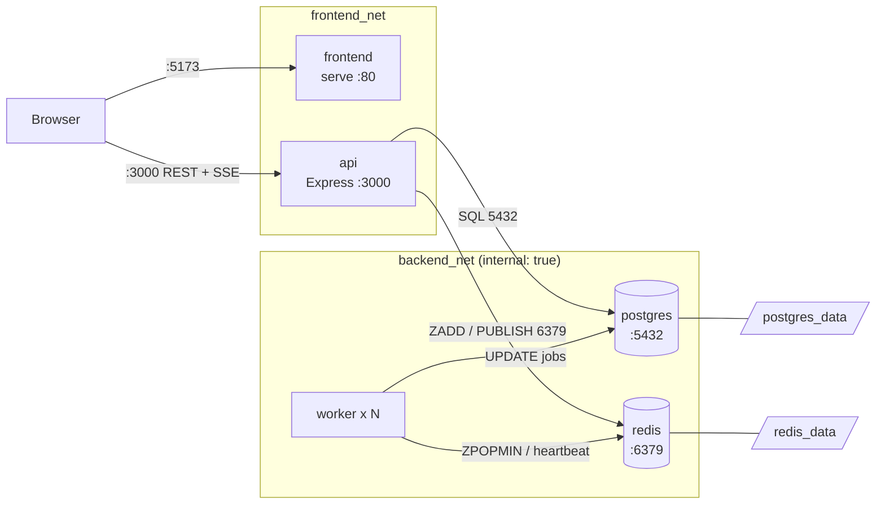

The API is the only service attached to both networks. Postgres and Redis publish no ports and are unreachable from outside Docker.

---

---

## Short explanation

**1. Why the API and worker are separate services.**
The API must answer HTTP requests quickly. Job processing (email, image resize, exports, webhooks) is slow, so it runs in separate worker containers. This keeps the API responsive, lets workers be scaled independently (`--scale worker=3`), and means a crashing worker does not take the API down.

**2. How the API and worker communicate through Redis.**
They never talk to each other directly. The API stores the job in PostgreSQL and adds its ID to a Redis sorted set (`ZADD taskwave:queue`). Workers poll that queue with `ZPOPMIN`, which is atomic, so two workers never take the same job. When a worker finishes, it updates the job in PostgreSQL and publishes an event on the Redis pub/sub channel `taskwave:events`. The API subscribes to that channel and forwards the update to the browser through Server-Sent Events. Workers also write heartbeats to Redis, which is how the Workers page knows which workers are alive.

**3. How containers resolve each other by Compose service name.**
Compose puts the services on shared networks and runs an internal DNS server. Every service name becomes a hostname on those networks, so the API connects to `postgres:5432` and `redis:6379` (see `DATABASE_URL` and `REDIS_URL` in `compose.yaml`) instead of IP addresses, which change on every restart. Resolution only works between services on the same network: `backend_net` joins the API, worker, postgres and redis, while the frontend sits only on `frontend_net` and cannot reach the database.

**4. How PostgreSQL data is persisted.**
The `postgres_data` named volume is mounted at `/var/lib/postgresql/data`, so the database files live in the volume rather than in the container's writable layer. Containers can be deleted and recreated and the data stays. `schema.sql` is mounted into `/docker-entrypoint-initdb.d/` and runs only the first time, when the volume is empty. Redis uses the same approach with `redis_data` and AOF persistence, so queued jobs survive a restart too.

**5. Why the frontend API URL must be reachable from the browser.**
The React app runs in the user's browser, not inside a container. The browser knows nothing about Docker's internal DNS, so `http://api:3000` cannot be resolved there. `VITE_API_URL` must be an address the browser can reach (`http://localhost:3000`, or `http://<SERVER_IP>:3000` on a server) and port 3000 must be published. Vite bakes the value into the JavaScript bundle at build time, so changing it requires `docker compose up -d --build frontend`.

**6. `docker compose down` vs `docker compose down -v`.**
- `docker compose down` removes the containers and networks but **keeps the named volumes**. After `docker compose up -d`, users and jobs are still there (tested: I signed in again and the jobs were listed).
- `docker compose down -v` also **deletes the volumes** (`postgres_data`, `redis_data`), which erases the database and the queue. On the next start Postgres initializes from scratch and runs `schema.sql` again.

## Project structure

```
docker-compose-demo-project/
├── apps/
│   ├── api/          Express API        (Dockerfile)
│   ├── frontend/     React + Vite UI    (Dockerfile, multi-stage)
│   └── worker/       Job consumer       (Dockerfile)
├── compose.yaml      Orchestration: services, networks, volumes, health checks
├── .dockerignore     Keeps node_modules and .env out of the images
├── .env.example      Template for configuration (copy to .env)
├── .gitignore        Ignores node_modules and .env
├── schema.sql        Database schema, applied on first Postgres start
└── README.md
```

---

## Prerequisites

- Docker Engine + Docker Compose v2 (check with `docker compose version`)
- On Windows/macOS: Docker Desktop must be **running** before any `docker compose` command

---

## Quick start

```bash
# 1. Create your environment file
cp .env.example .env

# 2. Edit .env (see "Configuration" below)

# 3. Validate the configuration
docker compose config

# 4. Build images and start everything
docker compose up -d --build

# 5. Check status (postgres, redis and api should be "healthy")
docker compose ps
```

Then open **http://localhost:5173**, register an account and sign in.

To stop: `docker compose down` (keeps data). To also delete data: `docker compose down -v`.

---

## Configuration

All settings live in `.env` (never committed; use `.env.example` as the template).

| Variable            | Purpose                                                                 |
|---------------------|-------------------------------------------------------------------------|
| `POSTGRES_USER`     | Database user                                                           |
| `POSTGRES_PASSWORD` | Database password – **change it**                                       |
| `POSTGRES_DB`       | Database name                                                           |
| `JWT_SECRET`        | Secret for signing login tokens – **change it**, use a long random string |
| `VITE_API_URL`      | Address the **browser** uses to reach the API                           |

`VITE_API_URL`:
- Browser on the same machine as Docker → `http://localhost:3000`
- Docker on a VM/server → `http://<SERVER_IP>:3000` (open ports 3000 and 5173 in the firewall)

It is baked into the frontend bundle at build time, so after changing it run `docker compose up -d --build frontend`.

---

## What was fixed in the original project

| File                  | Problem                                                                              | Fix                                         |
|-----------------------|--------------------------------------------------------------------------------------|---------------------------------------------|
| `apps/api/Dockerfile` | `COPY package*.json` copied the **root** package.json, so Express/pg/redis were never installed | `COPY apps/api/package*.json ./` |
| `apps/api/Dockerfile` | `npm install -g npm@...` was unnecessary and could fail                              | Removed                                     |
| api / worker          | Containers ran as root                                                               | `USER node`                                 |
| (missing)             | No `.dockerignore`: host `node_modules` (native `bcrypt` binary) and `.env` were copied into images | Added `.dockerignore`        |
| (missing)             | No compose file                                                                      | Added `compose.yaml`                        |
| repository            | `node_modules` committed                                                             | Removed, added `.gitignore`                 |

The build context is the project root for all three images because every Dockerfile copies from `apps/<service>/...`.

---

## Design explanation

### Networks
`frontend_net` connects the frontend and the API. `backend_net` connects the API, workers, PostgreSQL and Redis and is declared `internal: true`, so those services have no route to or from the outside world. Only the API sits on both networks. Postgres and Redis publish no ports. The frontend container only serves static files; the **browser** calls the API directly through the published port 3000.

### Volumes
- `postgres_data` stores the database.
- `redis_data` stores Redis AOF files, so queued jobs survive restarts.
- `docker compose down` keeps both volumes; `docker compose down -v` deletes them and all data.
- `schema.sql` is mounted into `/docker-entrypoint-initdb.d/` and runs **only when `postgres_data` is first created**.

### Dependencies and health checks
- Postgres: `pg_isready`
- Redis: `redis-cli ping`
- API: `GET /health`
- API and worker wait for `service_healthy` on postgres and redis; the frontend waits for a healthy API.
- All services use `restart: unless-stopped`.

Startup order: postgres + redis (healthy) → api + worker → frontend (after api is healthy).

### Communication
Containers reach each other by service name through Docker DNS (`postgres:5432`, `redis:6379`).

1. Browser → API: create a job
2. API → Postgres: store the job
3. API → Redis: `ZADD taskwave:queue`
4. Worker → Redis: `ZPOPMIN` (atomic, so no job is taken twice)
5. Worker processes the job → Postgres: update status
6. Worker → Redis pub/sub (`taskwave:events`) → API → browser via Server-Sent Events

### Why API and worker are separate
The API answers quickly and stays responsive; slow work runs in workers that can be scaled and restarted independently.

### Why `VITE_API_URL` must be browser-reachable
The React app runs in the user's browser, not inside a container, so `http://api:3000` cannot be resolved there. The value is baked into the JavaScript bundle at build time, so changing it requires a rebuild.

---

## Testing and results

Screenshots are in [`docs/screenshots/`](docs/screenshots).

### 1. Deployment and health
`docker compose ps` shows postgres, redis and api as `(healthy)`; frontend and worker are `Up`.

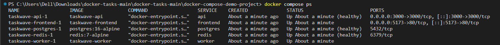
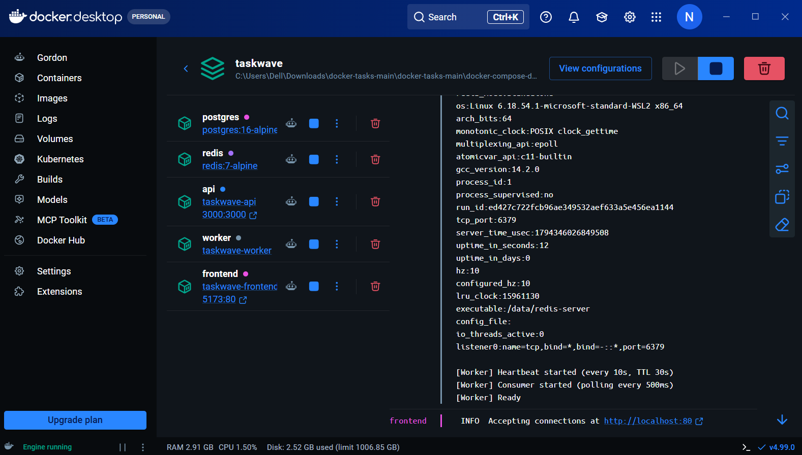

### 2. Component checks
```bash
docker compose exec redis redis-cli ping                                       # PONG
docker compose exec postgres sh -c 'pg_isready -U "$POSTGRES_USER" -d "$POSTGRES_DB"'
curl http://localhost:3000/health                                              # {"status":"ok",...}
```
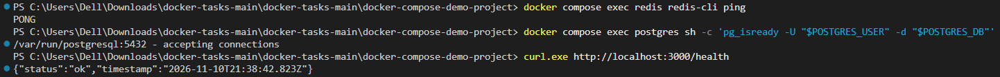

### 3. Functional test (UI)
Registered a user, then created one job of each type (`email`, `image_resize`, `data_export`, `webhook`). Statuses moved pending → running → completed.

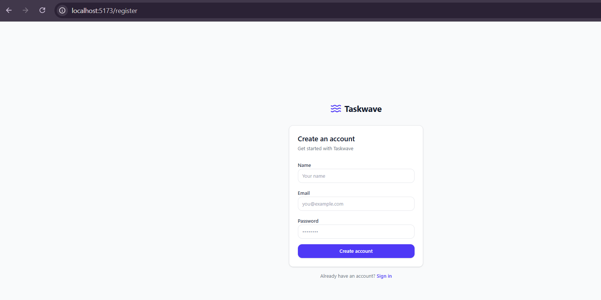
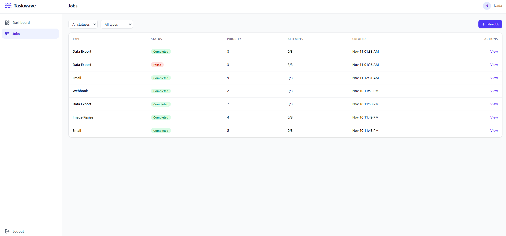
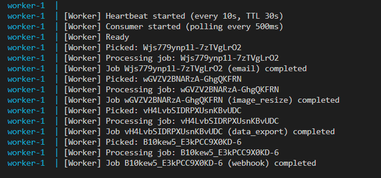

### 4. Queue behavior
With the worker stopped, a new job stays `pending` and its ID is visible in the Redis queue; after starting the worker it is processed.

```bash
docker compose stop worker
# create a job in the UI
docker compose exec redis redis-cli ZRANGE taskwave:queue 0 -1
docker compose start worker
```
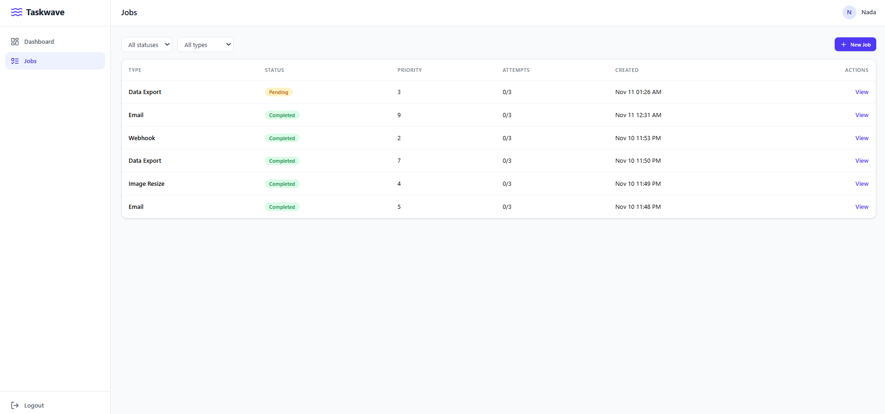

### 5. Persistence
`docker compose down` followed by `docker compose up -d` (without `-v`): the user account and all jobs were still present after signing in again.

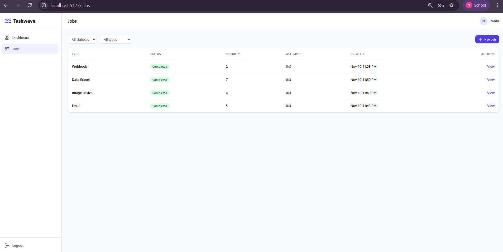

### 6. Worker scaling
```bash
docker compose up -d --scale worker=3
docker compose ps
docker compose logs worker | Select-String "Picked"     # PowerShell
```
Different worker containers pick different jobs. A job is never picked twice concurrently because `ZPOPMIN` is atomic. (A job ID appearing several times in the log is a **retry** of a failed job, not a duplicate execution.)


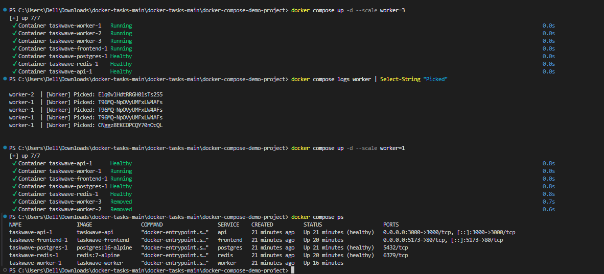

### 7. Recovery tests
```bash
docker compose kill worker
docker compose restart redis
docker compose logs --tail=30 api worker
```
Observed behavior:
- **Redis restart:** the API logged `ECONNREFUSED` while Redis was down, then reconnected. A job created afterwards was accepted and processed once a worker was running. AOF persistence keeps queued jobs.
- **Worker kill:** a worker stopped with `docker compose kill` was **not** restarted automatically (Docker treats a manual kill as an intentional stop under `restart: unless-stopped`), so it was started again with `docker compose start worker`. A crash inside the container (the process exiting) is restarted by the restart policy.
- **Retry logic:** a job that fails is retried with exponential backoff (2 s, then 4 s) and marked `failed` after 3 attempts.

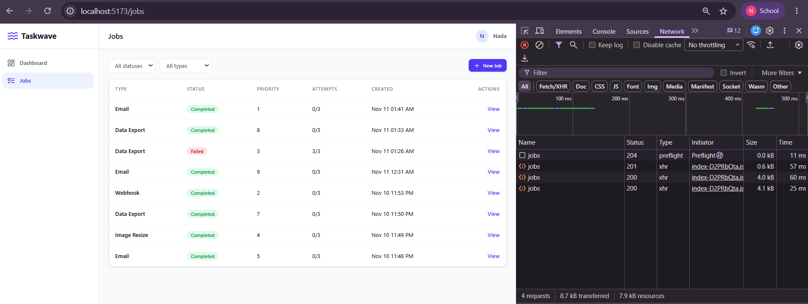

### 8. Browser → API
DevTools → Network shows the browser (page on `localhost:5173`) sending requests to `http://localhost:3000/jobs`, matching `VITE_API_URL`.

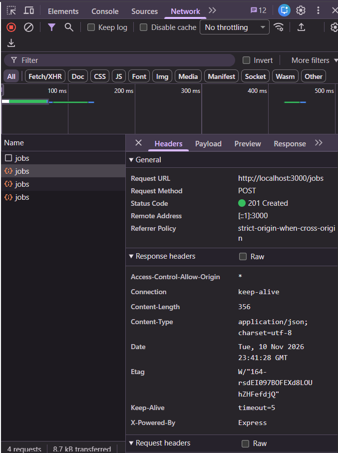

---

## Troubleshooting

| Symptom                                                        | Cause / fix                                                                                   |
|----------------------------------------------------------------|-----------------------------------------------------------------------------------------------|
| `failed to connect to the docker API ... dockerDesktopLinuxEngine` | Docker Desktop is not running – start it and wait for "Engine running"                    |
| API/worker cannot connect to Postgres after changing `POSTGRES_PASSWORD` | Postgres keeps the original password (init runs only on first volume creation). Restore the old password, or run `docker compose down -v` to reset all data |
| Frontend cannot reach the API                                  | Wrong `VITE_API_URL` at build time – fix `.env`, then `docker compose up -d --build frontend` |
| Job stays `pending`                                            | No worker running – `docker compose ps`, then `docker compose start worker`                   |
| Anything else                                                  | `docker compose logs <service>`                                                               |

---

